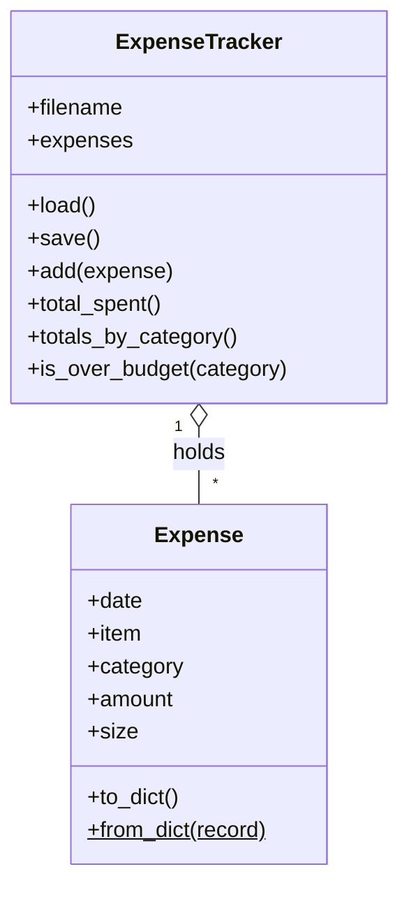

# 💰 Expense Tracker & Budget Analyzer

A Python project that grows module by module to answer one everyday question: **"Where does my money go?"**

Built as hands-on practice while completing **Python for Data Science, AI & Development** (part of the IBM DevOps and Software Engineering Professional Certificate on Coursera).


---

## 📖 About the Project

Most people don't know how much they spend on food, transport, or bills until the month is over. This command-line tool makes tracking simple: log what you spend, categorize it, compare it against budgets, and see where your money goes with summaries and a chart.

The project is built in stages. Each stage applies the concepts from one course module to a real-world problem, so the code evolves from a ten-line script into an object-oriented, data-driven application.

<!-- After adding your chart image to an images/ folder, uncomment the next line:

-->

## ✅ Current Features

**Tracking**
- Menu-driven app that runs until you quit
- Records the date, item, category, and amount of each expense
- Cleans messy input (extra spaces, inconsistent capitalization)
- Classifies each expense as Small, Medium, or Large
- Saves to a JSON file after every entry, so data survives restarts

**Validation and reliability**
- Rejects empty items, unknown categories, non-numbers, `nan`/`inf`, zero or negative amounts, and invalid or future dates, asking again for just the field that failed
- An `Expense` object validates itself on creation, so invalid data can't enter the system
- Handles a missing or corrupted data file without crashing or deleting your data (a corrupted file is kept as `expenses.json.corrupt`)
- Skips and reports invalid records when loading
- Exits cleanly on Ctrl+C / Ctrl+D

**Budgets and analysis (Pandas, NumPy, Matplotlib)**
- Spending per category compared with budget limits, with over-budget warnings
- Total, share of spending, and average per category
- Daily average, weekly totals, and the most expensive week
- Statistics on expense sizes (mean, median, standard deviation, 90th percentile) and a list of unusually large expenses
- A bar chart of spending per category, with budget limits marked, saved as `spending_chart.png`

### Example: analysis report

Running option 4 on the included sample data:

```
Period        : 2026-09-28 to 2026-10-24 (27 days)
Expenses      : 21
Total spent   : ₱11,595.00
Daily average : ₱429.44
Top category  : Bills (₱4,650.00, 40.1% of spending)

--- Budget status ---
Category             Spent        Budget     Used  Status
Food             ₱4,565.00     ₱3,000.00   152.2%  OVER
Bills            ₱4,650.00     ₱5,000.00    93.0%  OK
School           ₱1,795.00     ₱2,000.00    89.8%  OK
Other              ₱350.00     ₱1,000.00    35.0%  OK
Transport          ₱235.00     ₱1,500.00    15.7%  OK
```

## 🧩 How It's Designed

The program is built around two classes. Everything the user sees and types lives in separate plain functions, so the classes only deal with data and rules.



| Class | Responsibility |
|-------|----------------|
| `Expense` | One expense. Validates every field in its constructor, calculates its own `size` (a read-only property), converts to and from dictionaries, and prints itself with `__str__` / `__repr__`. |
| `ExpenseTracker` | The collection. Owns the list of `Expense` objects, loads and saves JSON, and answers questions like totals per category and whether a category is over budget. |

`analysis.py` only receives plain dictionaries, never the classes, so the Pandas code and the object model can change independently.

### Using the classes from Python

Importing `app.py` doesn't start the menu, so you can use the classes directly:

```python
from app import Expense, ExpenseTracker

tracker = ExpenseTracker("expenses.json")
tracker.load()

tracker.add(Expense("2026-10-25", "Lunch", "Food", 150))

print(len(tracker))                    # number of expenses
print(tracker.total_spent())           # total of everything
print(tracker.is_over_budget("Food"))  # True or False

Expense("2026-10-25", "Lunch", "gaming", 150)   # raises ValueError: invalid category
```

## 🛠️ Getting Started

### Prerequisites

- Python 3.10 or higher (tested on 3.12) ([download here](https://www.python.org/downloads/))

### Install and run

```bash
# Clone the repository
git clone https://github.com/codewithgaf/expense-tracker.git
cd expense-tracker

# Create and activate a virtual environment
python -m venv .venv
source .venv/bin/activate        # Windows: .venv\Scripts\activate

# Install the dependencies
pip install -r requirements.txt

# Run the app
python app.py
```

### Try it with sample data

```bash
cp sample_expenses.json expenses.json
python app.py                    # then choose option 4
```

> ⚠️ This overwrites any `expenses.json` you already have. Back it up first if it holds real data.

### Menu

| Option | What it does |
|--------|--------------|
| 1 | Add an expense |
| 2 | View all expenses in a table |
| 3 | Totals per category versus budget limits |
| 4 | Analyze spending with Pandas and save the chart |
| 5 | Quit |

## 🗺️ Roadmap

This project follows the course modules.

| Module | Topic | What gets built | Status |
|--------|-------|-----------------|--------|
| 1 | Python Basics | Input handling, string cleaning, formatted receipt | ✅ Done |
| 2 | Data Structures | Lists and dictionaries of expenses, totals per category, sets, slicing | ✅ Done |
| 3 | Programming Fundamentals | Conditions, loops, functions, exception handling, JSON file saving, `Expense` and `ExpenseTracker` classes | ✅ Done |
| 4 | Working with Data | Dates, analysis with Pandas and NumPy, charts with Matplotlib | ✅ Done |
| 5 | APIs and Data Collection | Multi-currency support using a live exchange-rate API | ⬜ Planned |

## 📚 What I'm Learning

- **Python basics:** user input, type conversion, string cleaning, f-string formatting
- **Data structures:** lists of dictionaries, sets, slicing, building totals with loops
- **Programming fundamentals:** conditions, loops, functions that separate logic from display, and exception handling (`try / except / else`, `raise`)
- **Objects and classes:** constructors that validate, properties, class methods, `__str__` and `__repr__`, and a collection class that holds other objects
- **File handling:** saving and loading JSON, protecting data from corrupted files
- **Data analysis:** DataFrames, `groupby`, resampling by week, NumPy statistics, Matplotlib charts
- **Workflow:** virtual environments, `requirements.txt`, `.gitignore`, and committing progress step by step

*This section is updated as each module is completed.*

## 🧱 Project Structure

```
.
├── app.py                       # Expense and ExpenseTracker classes, menu, input
├── analysis.py                  # Pandas / NumPy / Matplotlib analysis
├── requirements.txt             # pandas, numpy, matplotlib
├── sample_expenses.json         # Sample data for trying the analysis
├── module_1_basics.py           # Module 1 snapshot
├── module_2_data_structures.py  # Module 2 snapshot
├── .gitignore                   # Keeps .venv and personal data out of Git
└── README.md                    # Project documentation
```

## 🔮 Future Improvements

- Unit tests for `Expense` and `ExpenseTracker` with `pytest`, plus a CI pipeline with GitHub Actions
- Monthly budgets instead of all-time totals
- Multi-currency expenses with live exchange rates (Module 5)
- Edit and delete expenses from the menu
- Containerize with Docker and deploy

## 👤 Author

**Gafour Panolong**
- GitHub: [@codewithgaf](https://github.com/codewithgaf)
- LinkedIn: [gafourpanolong](https://www.linkedin.com/in/gafourpanolong)

## 📄 License

This project is for learning purposes. Feel free to use it as a reference.